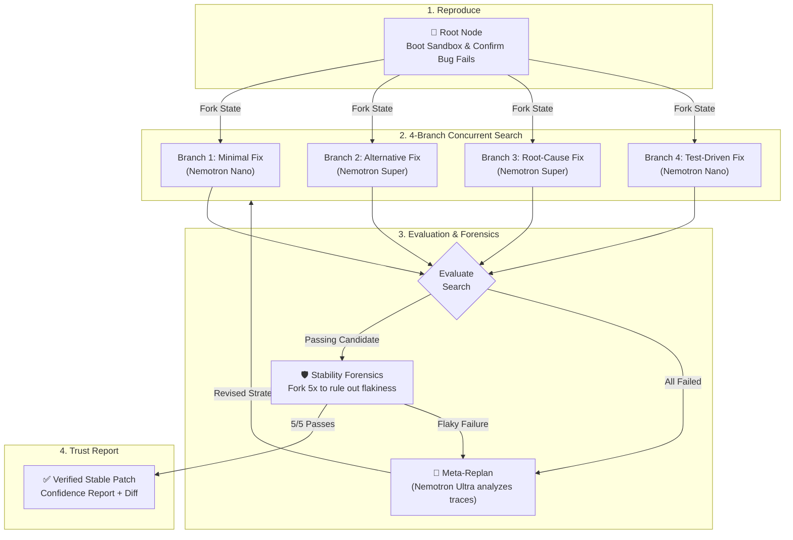

# 🌳 PatchTree

> **Autonomous AI agent that forks cloud sandboxes to explore, verify, and stress-test code patches before trusting them.**  
> *Built for the Nebius Token Factory x NVIDIA Global AI Hackathon (Coding & Agentic Engineering Track).*

---

<p align="center">
  
  
  
  
  
  
</p>

---

## ⚡ The Problem & The Idea

Most coding agents follow a fragile loop: **read the bug → generate one patch → hope the test passes**.

That’s a coin flip dressed up as software engineering. In real-world repositories:
1. **First guesses are often wrong** — single-shot agents get stuck without alternative paths.
2. **First passes are often lucky** — tests are frequently flaky (timing issues, test ordering, non-determinism).
3. **Green tests can hide regressions** — patches can pass the named test while silently breaking edge cases.

**PatchTree treats program repair as an empirical search-and-verify tree:**
- It **forks reality** at the exact checkpoint where a bug reproduces.
- It explores **4 diverse repair strategies concurrently** in isolated sandboxes.
- It **stress-tests the winner** across stability checks and adversarial test attacks before declaring victory.

---

## 🌲 How It Works: The Verification Tree



---

## 🛠️ Tech Stack & Model Routing

PatchTree pairs **Nebius Contree cloud sandboxing** with a **strictly tiered NVIDIA Nemotron cost strategy**:

| Layer | Technology | Role & Why |
|---|---|---|
| **Cloud Sandboxes** | **Nebius Contree SDK** | Instant container checkpointing, parallel forking, and isolated execution. |
| **Fast LLM Tier** | **NVIDIA Nemotron 3 Nano (30B)** | Cheap, high-throughput first-pass hypotheses and lightweight checks. |
| **Deep LLM Tier** | **NVIDIA Nemotron 3 Super (120B)** | Architectural refactoring, root-cause repair, and adversarial test attacks. |
| **Reasoning Tier** | **NVIDIA Nemotron 3 Ultra (550B)** | Failure-trace analysis across rounds, meta-planning, and final confidence reporting. |
| **API Server** | **FastAPI + Pydantic v2** | High-concurrency async orchestrator managing background tree tasks. |
| **Persistence** | **Supabase (PostgreSQL)** | Persistent storage for run metadata, node execution trees, and metrics. |
| **Frontend** | **React + Vite + TypeScript** | Interactive live tree visualization (React Flow) and confidence diff inspect panel. |

---

## 📁 Repository Structure

```text
PatchTree/
├── Backend/
│   ├── app/
│   │   ├── main.py               # FastAPI entrypoint & REST API endpoints
│   │   ├── orchestrator/         # Repair pipeline & multi-branch search state machine
│   │   ├── llm/                  # Nemotron tiered model router (Nano / Super / Ultra)
│   │   ├── sandbox/              # Contree SDK client wrapper with in-memory fallback
│   │   ├── models/               # Pydantic schemas (Run, Node, Tree)
│   │   └── db/                   # Supabase client & schemas
│   ├── tests/                    # End-to-end automated unit & integration test suites
│   ├── requirements.txt
│   └── .env.example
├── Frontend/                     # React + TypeScript tree visualization UI
├── docs/                         # Architecture, decision logs, and specifications
├── AGENTS.md                     # Agent engineering protocols
└── README.md
```

---

## 🚀 Quickstart

### 1. Prerequisites
- Python 3.11+
- [Nebius Token Factory](https://tokenfactory.nebius.com) API Key & Project ID

### 2. Setup Backend
```bash
# Clone the repository
git clone https://github.com/Aman-art1/PatchTree.git
cd PatchTree/Backend

# Create and activate virtual environment
python -m venv venv
# Windows:
.\venv\Scripts\activate
# Linux / macOS:
source venv/bin/activate

# Install dependencies
pip install -r requirements.txt

# Configure environment variables
cp .env.example .env
# Fill in your NEBIUS_API_KEY and NEBIUS_PROJECT_ID in .env
```

### 3. Run Verification Tests
PatchTree includes automated suites verifying API endpoints, Nemotron LLM routing, and cloud sandboxes:

```bash
# Fast API & schema tests (0.06s)
python tests/test_api.py

# Multi-branch Nemotron LLM search test
python tests/test_search.py

# Full evaluate & Ultra replan state machine test
python tests/test_evaluate.py

# Live Nebius Contree cloud sandbox test
python tests/test_real_contree.py
```

### 4. Start Development API Server
```bash
uvicorn app.main:app --reload --port 8000
```
Visit `http://localhost:8000/docs` to test interactive Swagger API endpoints.

---

## 🏆 Hackathon Context

Built for the **Nebius x NVIDIA Global AI Hackathon (October 2026)**.  
*Track: Coding and Agentic Engineering (Agents that write, run, and test code in Token Factory Sandboxes).*

- **Contree Primitives Exploited:** OCI lightweight image import, snapshot checkpoints, parallel child forking, and non-cached deterministic command execution.
- **Model Efficiency:** Over 80% of tokens run on cheap Nano/Super endpoints, reserving 550B Ultra exclusively for failure reasoning.

---

<p align="center">
  <sub>Built with ❤️ by the PatchTree Team. Released under the MIT License.</sub>
</p>