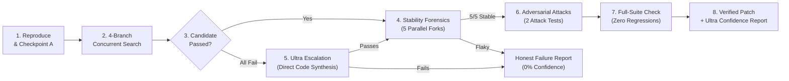
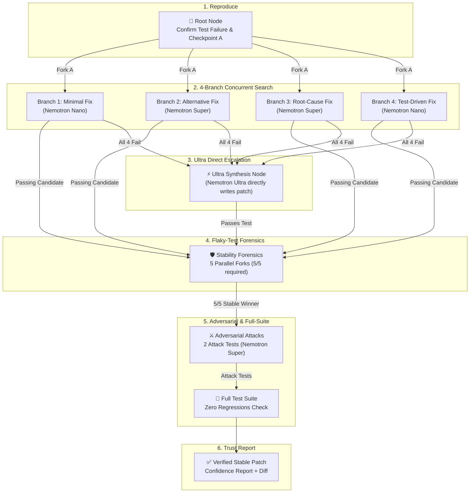

# PatchTree

> **Autonomous AI agent that forks cloud sandboxes to explore, verify, and stress-test code patches before trusting them.**  
> *Built for the Nebius Token Factory x NVIDIA Global AI Hackathon (Coding & Agentic Engineering Track).*

---

<p align="center">
  
  
  
  
  
  
</p>

---

## ⚡ The Problem & The Solution

Most coding agents follow a fragile loop: **read the bug → generate one patch → hope the test passes**.

In production software, that is a coin flip dressed up as software engineering:
- **First guesses are often wrong** — single-shot agents hit dead ends with no systematic fallback.
- **First passes are often lucky** — tests are frequently flaky due to concurrency, timing, or execution order.
- **Green tests can hide regressions** — patches can pass the named test while breaking edge cases or weakening assertions.

| Capability | Standard Single-Shot Agents | PatchTree |
|---|---|---|
| **Exploration Strategy** | Single sequential attempt | **4-Way Concurrent Search** across distinct hypotheses |
| **Sandbox Isolation** | Reuses dirty container state | **Contree Snapshot Checkpointing & Clean Forking** |
| **Flakiness Handling** | Assumes 1 green run = permanent fix | **5-Fork Stability Forensics** to verify true stability |
| **Adversarial Hardening** | None (stops at first pass) | **Attack Forks** where a secondary model tries to break the patch |
| **Recovery on Failure** | Blind prompt retry | **Nemotron Ultra Direct Escalation**: 550B flagship directly synthesizes the fix from failure traces |
| **Final Output** | Unverified diff | **Diff + Decision-Ready Confidence Report + Execution Tree** |

---

## 🔄 How Errors Are Solved: The Lifecycle

PatchTree moves through distinct verification stages:



1. **Reproduction & Checkpoint A**  
   The sandbox boots the environment, runs the target test command, confirms the exact failure trace, and saves **Checkpoint A**. If an error cannot be reproduced, execution halts honestly.
2. **Concurrent Search Fan-Out**  
   PatchTree forks four independent copies of Checkpoint A simultaneously:
   - **Branch 1 (Minimal Fix — Nemotron Nano):** Direct, surgical patch targeting only the immediate symptom.
   - **Branch 2 (Alternative Strategy — Nemotron Super):** Explores alternative implementations or refactoring.
   - **Branch 3 (Root-Cause Fix — Nemotron Super):** Investigates deeper causes across callers or dependencies.
   - **Branch 4 (Test-Driven Fix — Nemotron Nano):** Strictly implements expected contract specifications.
3. **Flaky-Test Forensics (Stability Layer)**  
   When a patch turns green, PatchTree does **not** stop there. It forks the winning checkpoint $k$ times ($k=5$) and re-runs the identical test command across all five forks in parallel to ensure the pass was deterministic. If any fork fails, the patch is demoted as flaky.
4. **Adversarial Self-Testing (Attack Layer)**  
   Nemotron Super (120B) inspects the patch diff and generates $m=2$ targeted attack test functions probing edge cases, boundary conditions, and floating-point quirks to verify the fix is not narrow.
5. **Full-Suite Regression Verification**  
   Runs the entire repository test suite (`pytest`) on the winning candidate checkpoint to guarantee zero regressions.
6. **Ultra-Tier Confidence Reporting & Direct Escalation**  
   - **If successful:** Nemotron Ultra (550B) synthesizes all telemetry (stability pass rate, attack survival, regression result, cost, and wall time) into an executive confidence report.
   - **If all branches fail:** Nemotron Ultra steps in directly. It ingests the complete failure context (hypotheses, patch diffs, and exact pytest traces from all 4 branches) and synthesizes a direct code patch (`generate_patch_ultra`). If Ultra's patch passes, it proceeds through stability and adversarial checks; if it fails, it generates an honest failure report.

---

## 🌲 Tree Architecture



---

## 🛠️ Tech Stack & Model Routing

| Layer | Technology | Role & Why |
|---|---|---|
| **Cloud Sandboxes** | **Nebius Contree SDK** | Instant container checkpointing, parallel forking, and isolated execution. |
| **Fast LLM Tier** | **NVIDIA Nemotron 3 Nano (30B)** | Cheap, high-throughput first-pass hypotheses and lightweight checks. |
| **Deep LLM Tier** | **NVIDIA Nemotron 3 Super (120B)** | Architectural refactoring, root-cause repair, and adversarial test generation. |
| **Reasoning Tier** | **NVIDIA Nemotron 3 Ultra (550B)** | Multi-trace failure analysis, meta-planning, and confidence reporting. |
| **API Server** | **FastAPI + Pydantic v2** | High-concurrency async orchestrator managing background tree tasks. |
| **Persistence** | **Supabase (PostgreSQL)** | Persistent storage for run metadata, node execution trees, and metrics. |
| **Frontend** | **React + Vite + TypeScript** | Interactive live tree visualization (React Flow) and diff inspection panel. |


---

## 🏛️ System Architecture: Backend & Frontend

### ⚙️ Backend Core (`Backend/`)
- **FastAPI Async Engine:** Manages background execution of repair runs and exposes RESTful endpoints (`POST /api/runs`, `GET /api/runs/{id}`, `GET /api/runs/{id}/tree`, `GET /api/runs/{id}/report`).
- **Pipeline Orchestrator (`pipeline.py`):** Coordinates the 5 verification phases:
  1. *Reproduction:* Sandboxed test run and baseline Checkpoint A creation.
  2. *Concurrent Search:* 4 parallel forks exploring Minimal, Alternative, Root-Cause, and Test-Driven patches.
  3. *Stability Forensics:* 5 parallel forks re-running tests to detect flaky candidates.
  4. *Adversarial Hardening:* 2 attack forks generating targeted edge-case tests.
  5. *Regression Verification:* Full-suite test run ensuring zero repo-wide breakage.
- **Dynamic Model Router (`router.py`):** Automatically distributes tasks across NVIDIA Nemotron 3 Nano (30B), Super (120B), and Ultra (550B) to balance speed, intelligence, and cost.
- **Cloud & Mock Sandboxing (`contree_client.py`):** Integrates Nebius Contree cloud container snapshots with automatic zero-dependency in-memory mocking for local offline tests.
- **Persistence & Telemetry:** Persists run metadata and execution trees in Supabase (PostgreSQL), recording per-node wall time, token consumption, and dollar costs.

### 💻 Frontend Dashboard (`Frontend/`)
- **Modern Single-Page UI:** Built with React 19, TypeScript, and Vite for lightning-fast performance and clean UI styling.
- **Live Tree DAG (`@xyflow/react` + `dagre`):** Automatically organizes the execution tree into a clear hierarchical layout, dynamically mapping parent-child relationships across all 13 nodes.
- **Interactive Node Inspector:** Click any node to open a sliding inspection drawer displaying the unified diff patch, raw terminal outputs, model tier, and token metrics.
- **Live Pipeline Stepper:** Visual status breadcrumb tracking real-time progress through Reproduce, Search, Stability, Adversarial, Full-Suite, and Ultra Report phases.
- **Confidence Score & Report Modal:** Visual circular SVG score gauge alongside Nemotron Ultra's full Markdown evaluation report.
- **Interactive Run Modal:** Allows submitting custom GitHub repositories and test commands, complete with one-click quick-fill presets for immediate testing.

## 📁 Repository Structure

```text
PatchTree/
├── Backend/
│   ├── app/
│   │   ├── main.py               # FastAPI entrypoint & REST API endpoints
│   │   ├── orchestrator/         # Repair pipeline & multi-branch search state machine
│   │   ├── llm/                  # Nemotron tiered model router (Nano / Super / Ultra)
│   │   ├── sandbox/              # Contree SDK client wrapper with in-memory fallback
│   │   ├── models/               # Pydantic schemas (Run, Node, Tree)
│   │   └── db/                   # Supabase client & schemas
│   ├── tests/                    # End-to-end automated unit & integration test suites
│   ├── requirements.txt
│   └── .env.example
├── Frontend/                     # React + TypeScript tree visualization UI
├── docs/                         # Architecture, decision logs, and specifications
├── AGENTS.md                     # Agent engineering protocols
├── LICENSE                       # Mozilla Public License 2.0
└── README.md
```

---

## 🚀 Quickstart

### 1. Prerequisites
- Python 3.11+
- [Nebius Token Factory](https://tokenfactory.nebius.com) API Key & Project ID

### 2. Setup Backend
```bash
# Clone the repository
git clone https://github.com/icodesAS/PatchTree.git
cd PatchTree/Backend

# Create and activate virtual environment
python -m venv venv
# Windows:
.\venv\Scripts\activate
# Linux / macOS:
source venv/bin/activate

# Install dependencies
pip install -r requirements.txt

# Configure environment variables
cp .env.example .env
# Fill in your NEBIUS_API_KEY and NEBIUS_PROJECT_ID in .env
```

### 3. Run Verification Tests
PatchTree includes automated suites verifying all 5 verification layers:

```bash
# 1. Fast API, schemas & 13-node tree tests
python tests/test_api.py

# 2. Flaky-test stability forensics (5 forks)
python tests/test_stability.py

# 3. Adversarial attacks & survival verification
python tests/test_adversarial.py

# 4. Full-suite check & Nemotron Ultra confidence report
python tests/test_report.py

# 5. Multi-branch Nemotron search test
python tests/test_search.py

# 6. Live Nebius Contree cloud sandbox test
python tests/test_real_contree.py
```

### 4. Start Development API Server (Port 8000)
```bash
uvicorn app.main:app --reload --port 8000
```
Visit `http://localhost:8000/docs` to test interactive Swagger API endpoints.

### 5. Start Frontend UI (Port 5173)
```bash
cd ../Frontend
npm install
npm run dev
```
Visit `http://localhost:5173` for the interactive tree visualization dashboard.

---

## 🏆 Hackathon Context & Licensing

Built for the **Nebius x NVIDIA Global AI Hackathon (October 2026)**.  
*Track: Coding and Agentic Engineering (Agents that write, run, and test code in Token Factory Sandboxes).*

- **Contree Primitives Exploited:** OCI lightweight image import, snapshot checkpoints, parallel child forking, and non-cached deterministic command execution.
- **Model Efficiency:** Over 80% of tokens run on cheap Nano/Super endpoints, reserving 550B Ultra exclusively for failure reasoning.
- **License:** Open-source software released under the **[Mozilla Public License 2.0 (MPL-2.0)](LICENSE)**.

---

<p align="center">
  <sub>Licensed under the <a href="LICENSE">Mozilla Public License 2.0</a>.</sub>
</p>